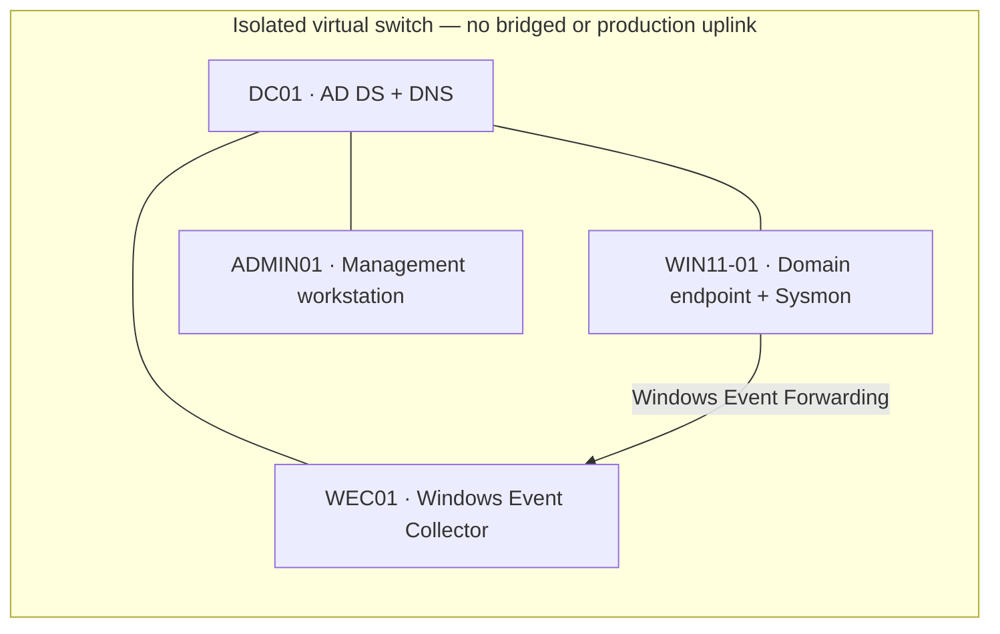

# Active Directory Security & Detection Lab

A defensive, isolated Windows domain lab for practicing identity hardening, endpoint telemetry, centralized event collection, and detection triage. Designed for a systems administrator and cybersecurity analyst portfolio.

> This repository is a lab blueprint and offline detection demo. It has not been deployed or validated on live Windows hosts. Build only on isolated VMs with synthetic accounts and test data.

## Lab topology



| VM | Example address | Role |
| --- | --- | --- |
| DC01 | 10.50.0.10/24 | Windows Server domain controller and DNS |
| WEC01 | 10.50.0.20/24 | Windows Event Collector |
| WIN11-01 | DHCP reservation or 10.50.0.31/24 | Domain joined endpoint, Sysmon telemetry |
| ADMIN01 | DHCP reservation or 10.50.0.41/24 | Separate admin workstation |
| Gateway | None | No internet or production route |

Use a private/internal virtual switch in Hyper-V or an isolated network in Proxmox. A domain controller, collector, and endpoint may share this small lab subnet; production networks should use a separately designed management and client segmentation model.

## Quick start

1. Create VM snapshots and an isolated virtual switch with no bridged uplink.
2. Build Windows Server 2022 VMs for DC01 and WEC01, plus Windows 11 client and admin VMs. Assign the example addresses and use DC01 for DNS.
3. Promote DC01 to a new lab forest such as `lab.example.test`. Use unique lab-only credentials and record them outside the repository.
4. Join WEC01, WIN11-01, and ADMIN01 to the lab domain. Keep the administrator workstation separate from everyday user accounts.
5. Apply the GPO and event-collection steps in [the build guide](docs/build-guide.md). Install Sysmon on the endpoint with the reviewed sample config in [configs/sysmon/lab-sysmon.xml](configs/sysmon/lab-sysmon.xml).
6. Review the detections and expected test cases in [the detection guide](docs/detections.md). Generate only benign test activity in the isolated lab and confirm event collection.
7. Run the offline JSONL demo and tests (Python 3.10+; standard library only):

   ```bash
   python -m unittest discover -s tests -v
   python tools/triage_events.py samples/events.jsonl
   ```

The sample dataset contains synthetic event-shaped records and demonstrates three detections: a burst of failed logons, a security group membership change, and suspicious PowerShell indicators. It is not a real Windows event export and does not prove the Sigma rules work in any SIEM.

## What this demonstrates

- Read-only domain, password policy, domain controller, and privileged group inventory
- Domain account and Group Policy baseline planning
- Separate privileged access and least-privilege administration
- Windows audit policy and Sysmon telemetry configuration
- Windows Event Forwarding and Windows Event Collector setup
- Sigma detection authoring with source, tuning notes, and false-positive guidance
- Offline event triage with synthetic fixtures and unit tests
- Reproducible documentation and GitHub Actions checks

## Project status and limitations

- **Built in this repository:** topology, build and validation guides, sample Sysmon XML, three Sigma rules, synthetic JSONL fixtures, Python triage script, tests, and CI.
- **Not performed by CI:** Windows Server installation, domain creation, GPO application, Sysmon installation, event forwarding, SIEM rule conversion, or end-to-end host testing.
- The Python triage code consumes the normalized JSONL schema documented in [event format](docs/event-format.md). It is an educational demo, not a production SIEM or forensic parser.
- Sigma rules are examples. Validate field names and event collection against the Windows version, logging configuration, and target SIEM before relying on them.
- Use synthetic accounts and benign test activity. Never include customer logs, credentials, domain names, or exported production configurations.

## Repository map

- `docs/` — build sequence, detections, validation, event schema, and response notes
- `configs/sysmon/` — small, reviewed lab configuration
- `rules/windows/` — portable Sigma rule examples
- `samples/` — synthetic normalized events only
- `scripts/Get-LabIdentityPosture.ps1` — read-only AD and privileged-group inventory
- `tools/triage_events.py` — offline detection demonstration
- `tests/` — behavior and schema tests

## References

See [official references](docs/references.md). The Microsoft WEF guide explains forwarding selected event channels to a Windows Event Collector. Microsoft describes Sysmon as telemetry collection; analysis is performed by a downstream collector or SIEM. Sigma provides a vendor-neutral rule specification.
